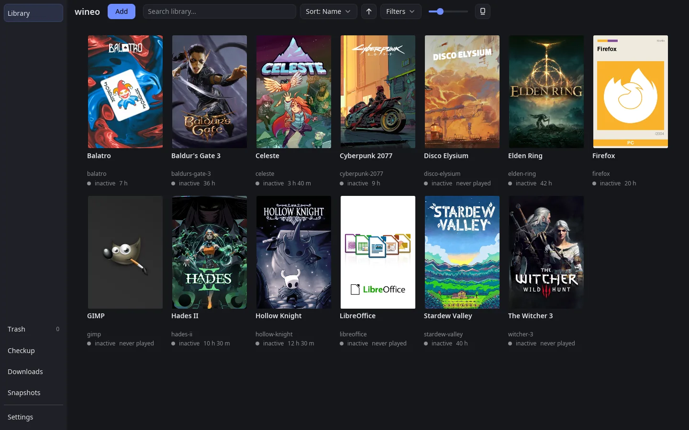
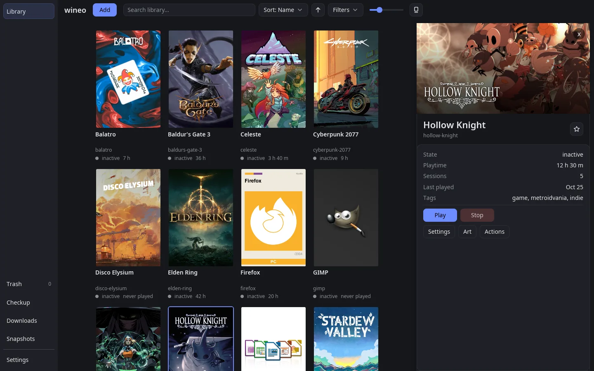
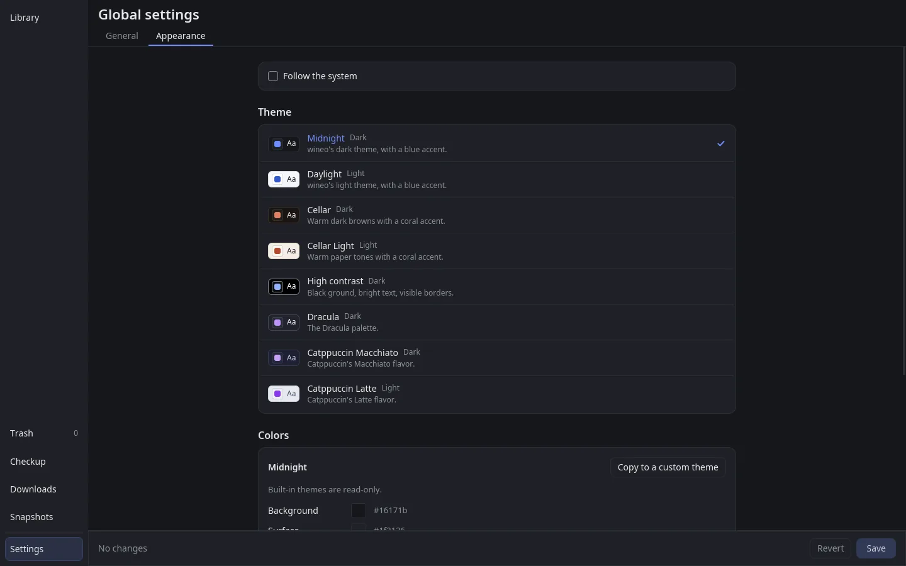

# wineo

[](https://github.com/MeandrousShark/wineo/releases)
[](LICENSE)


A launcher and library for Linux, written in Rust, for Windows programs and
games run with Wine or Proton, native Linux games, your Steam library, and
the GOG games you own. Each one gets its own named environment. For Windows
software that's a prefix, a runner (Wine or Proton through umu), launch
targets, and settings, all in plain TOML you can read and edit. Use it from
the command line or the desktop app.



```sh
wineo new                  # guided setup: runner, template, installer or exe
wineo start hades          # launch in the background
wineo status               # what's running
wineo stop hades
```

## Why wineo

Bottles, Lutris, and Heroic are all good at what they do. wineo gives you
two first-class ways in: a desktop app for browsing and playing your
library, and a `wineo` command for the terminal. Nearly everything the app
does is a command too, and the command adds `--json` output and documented
exit codes for scripts. Nothing lives in a hidden database: each
environment is a TOML file you can read, edit by hand, or keep in git, and
wineo's own edits keep your comments and formatting. The desktop app works
on those same files and the same run state, so a game started from a script
shows as running in the app, and a change made in either one shows up in
the other.

## Install

### Arch Linux

The repository has a `wineo-git` PKGBUILD that builds the latest `main` and
installs both programs, the desktop app's menu entry, shell completions, and
man pages:

```sh
git clone https://github.com/MeandrousShark/wineo.git
cd wineo
makepkg -si
```

Run `makepkg -si` again from the same directory to update.

`makepkg` writes the version it built into the PKGBUILD's `pkgver` line. To
keep git from showing that as a change, run this once in the clone:

```sh
git config filter.pkgver.clean "sed 's/^pkgver=.*/pkgver=0/'"
git config filter.pkgver.smudge cat
```

### Prebuilt binaries

Each [release](https://github.com/MeandrousShark/wineo/releases) has a
`wineo-X.Y.Z-x86_64-linux.tar.gz` with `wineo` and `wineo-gui`, built for
x86_64 Linux with glibc 2.35 or newer (Ubuntu 22.04, Debian 12, Fedora 36,
and later). To install a release into `~/.local/bin`:

```sh
version=1.0.0
curl -LO https://github.com/MeandrousShark/wineo/releases/download/v$version/wineo-$version-x86_64-linux.tar.gz
tar -xzf wineo-$version-x86_64-linux.tar.gz
install -Dm755 -t ~/.local/bin wineo-$version-x86_64-linux/wineo wineo-$version-x86_64-linux/wineo-gui
```

On Ubuntu or Debian, install these packages for the desktop app with
`sudo apt install`:

<!-- ubuntu-runtime-packages:start -->
```
libx11-6
libx11-xcb1
libxcb1
libxkbcommon0
libxkbcommon-x11-0
libxcursor1
libxi6
libwayland-client0
libwayland-egl1
libegl1
libvulkan1
```
<!-- ubuntu-runtime-packages:end -->

On Fedora, install these packages with `sudo dnf install`:

<!-- fedora-runtime-packages:start -->
```
libX11
libX11-xcb
libxcb
libxkbcommon
libxkbcommon-x11
libXcursor
libXi
libwayland-client
libwayland-egl
libglvnd-egl
vulkan-loader
```
<!-- fedora-runtime-packages:end -->

### From source

You need a recent stable Rust toolchain (the workspace uses the 2024
edition), a C compiler, and `pkg-config`. Build and install both programs:

```sh
git clone https://github.com/MeandrousShark/wineo.git
cd wineo
cargo build --release -p wineo-cli -p wineo-gui
install -Dm755 -t ~/.local/bin target/release/wineo target/release/wineo-gui
```

### After installing

Make sure `~/.local/bin` is on your `PATH`. The prebuilt and source
installs don't add the desktop app to your app menu. To add it, fetch its
entry and icon:

```sh
base=https://raw.githubusercontent.com/MeandrousShark/wineo/main/crates/wineo-gui/assets
curl -fLo ~/.local/share/applications/wineo-gui.desktop --create-dirs $base/wineo-gui.desktop
curl -fLo ~/.local/share/icons/hicolor/scalable/apps/wineo-gui.svg --create-dirs $base/wineo-gui.svg
```

See [Shell completion](docs/shell-completion.md) to set up completions.
To install the man pages, write them into a folder your `man` searches:

```sh
wineo manpages ~/.local/share/man/man1
```

### Runtime dependencies

- `wine` to run Windows programs with Wine
- `umu-launcher` to run Proton environments
- `winetricks` for `wineo winetricks`
- `gamemode`, `gamescope`, and `mangohud` for targets that turn them on
- a Secret Service keyring (GNOME Keyring, KWallet) on the D-Bus session bus
  to store your SteamGridDB and Steam Web API keys and your GOG login.
  Without one, wineo keeps them in plain text files that only your user can
  read, in `~/.local/share/wineo/`, and warns when it saves one.

## Features

- **Guided setup.** `wineo new` walks through the runner, a template, an
  installer or existing executable, and SteamGridDB art, then offers the
  programs it finds as launch targets.
- **Wine and Proton.** Use system Wine, downloaded Wine builds, or Proton
  through `umu-launcher`. `wineo download` fetches runners, DXVK, and
  vkd3d-proton with checksum verification, or use
  [Wine and Proton builds already installed by Steam, Heroic, or Lutris](docs/downloads-and-imports.md#use-builds-from-steam-heroic-and-lutris).
- **Native Linux games.** [Native games](docs/native.md) get the same
  library, launch targets, launch options, art, and playtime as everything
  else, with no prefix or runner.
- **Targets.** Each environment can have several launch targets, one of them
  the default, with their own arguments, working directory, and desktop entry.
- **Supervised runs.** `start` runs in the background, `stop` ends the whole
  process tree, and `logs` shows the output. `run` stays attached to the
  terminal.
- **Imports.** Adopt or copy an existing prefix, or import games from Heroic
  with their launch settings.
- **Steam games.** Bring [Steam games](docs/steam.md) into the library,
  installed or just owned, to tag, launch, stop, and track playtime, while
  Steam keeps managing them. Owned games can be installed through Steam
  from wineo.
- **GOG games.** Log in and install the [GOG games](docs/gog.md) you own,
  native or Windows, or move the ones Heroic installed into wineo, then keep
  them and their DLC up to date. No GOG Galaxy client needed.
- **Clones, snapshots, and portable folders.** Copy an environment, snapshot
  and restore its prefix on a filesystem with reflinks (Btrfs, XFS), or keep
  everything in a folder you can move to another drive.
- **Artwork.** Store icons, posters, heroes, and logos per environment, from
  your own files or SteamGridDB.
- **Desktop app.** A poster library of everything you have, with guided
  flows for the rest. See [Desktop app](#desktop-app) below.
- **Scripting friendly.** `--json` output for `status` and `list`, and live
  shell completion for environment and target names.

## Desktop app

`wineo-gui` is wineo's desktop app. It uses the same configs, prefixes, and
run state as the CLI, so you can switch between the two whenever you like:
a game started from the terminal shows as running in the app within a
couple of seconds.

<p>
  
  
</p>

- **Library.** Every environment is a poster card with its art, whether
  it's running, and how long you've played it. Search by title, name, or
  tag; sort by name, last played, playtime, or date added; and filter by
  store (Steam, GOG, Epic, Amazon), platform, or tag. Star favorites, hide
  what you don't want to see, zoom the grid from 60% to 200%, or switch to
  posters only.
- **A panel for each game.** Click a card for its hero art and logo, state,
  playtime, sessions, and tags, with Play and Stop, the live log, settings,
  art, and more actions. Double-click a card to launch it right away.
- **Add and import.** Guided flows create an environment from an installer
  or a program already on disk, import a prefix, or bring in games from
  Heroic, Steam, and GOG. Clones work the same way. Each one ends in a
  review before anything changes.
- **Settings.** Each environment has a page for its title, runner, launch
  options, targets, and environment variables. The global page holds the
  defaults for new environments and launches, art fetching, API keys, and
  your GOG login. Edits collect until you save them.
- **Art.** Choose icons, posters, heroes, and logos from your own files or
  from SteamGridDB.
- **Upkeep.** Trash restores removed environments, Checkup runs
  `wineo validate` over everything, Downloads shows which runners and
  graphics builds are in use, and Snapshots saves and restores prefixes.
  Wine environments can run a program or winetricks verbs, or be copied to
  a portable folder.
- **Themes.** The app follows your desktop's light or dark mode. Pick from
  eight built-in themes (Midnight, Daylight, Cellar, Cellar Light, High
  contrast, Dracula, and Catppuccin Macchiato and Latte), or make your own,
  saved as plain TOML files you can share. An option raises text contrast
  in any theme.
- **Keyboard.** Arrow keys move between cards, Enter opens a card and then
  plays it, F stars it, and Ctrl+= and Ctrl+- zoom.

Start it with `wineo-gui`, or from your app menu once it has an entry (see
[After installing](#after-installing)). Everything it does is covered in
the [Desktop app guide](docs/gui.md).

## Usage

Every command has `--help`. The common ones:

| Task | Command |
|---|---|
| Create an environment | `wineo new` (guided), or write `environments/<name>.toml` by hand from [`docs/environment.toml.example`](docs/environment.toml.example) |
| Add a game already on disk, with a desktop entry | `wineo new -n palworld --exe ~/Games/Palworld/Palworld.exe -d` |
| Add a native Linux game | `wineo new -n rimworld --native --exe ~/Games/RimWorld/start.sh -d`, or by hand from [`docs/native-environment.toml.example`](docs/native-environment.toml.example) |
| List environments, or only tagged ones | `wineo list`, `wineo list --tag game` |
| Tag environments | `wineo set hades 'tags=["game", "co-op"]'` |
| Launch the default target, or a named one | `wineo start hades`, `wineo start hades.server` |
| Launch attached to the terminal | `wineo run hades` |
| Check and stop runs | `wineo status`, `wineo stop hades`, `wineo logs hades` |
| Add, edit, or remove targets, or run an installer | `wineo setup hades` |
| Run some other exe in the prefix | `wineo exec hades path/to/tool.exe` |
| Install Windows components, once or on every launch | `wineo winetricks hades vcrun2022`, `wineo set hades 'winetricks=["vcrun2022"]'` |
| Change settings | `wineo set hades key=value`, `wineo config hades` |
| Run a command before a launch or after it ends | `wineo set hades 'hooks.before=mount /mnt/games'` |
| Use gamescope, MangoHud, or Wine Wayland | `wineo set hades mangohud=true wayland=true gamescope.window=fullscreen` |
| Manage runners and components | `wineo runners`, `wineo download`, `wineo dxvk`, `wineo vkd3d` |
| Import a prefix or Heroic games | `wineo import` |
| Import installed Steam games | `wineo import steam --all` |
| Preview `new` or `import` without changing anything | `wineo new -n hades --exe ~/Games/Hades/Hades.exe --dry-run`, `wineo import heroic --all --dry-run` |
| Copy, snapshot, or go portable | `wineo clone`, `wineo snapshot`, `wineo portable` |
| Artwork | `wineo art fetch hades`, `wineo art list hades` |
| Find and fix config problems | `wineo validate` |
| See how much you've played | `wineo stats`, `wineo stats hades` |
| Remove, restore, or permanently delete an environment | `wineo rm hades`, `wineo trash`, `wineo restore ID`, `wineo prune ID` |

Configs live in `$XDG_CONFIG_HOME/wineo/`, prefixes and data in
`$XDG_DATA_HOME/wineo/`, and run state in `$XDG_STATE_HOME/wineo/`, unless
you pass `--portable DIR` or set it up for a portable folder.

### More documentation

- [Desktop app](docs/gui.md)
- [GUI style guide](docs/gui-style.md)
- [Config files](docs/config-files.md)
- [Native Linux games](docs/native.md)
- [Steam games](docs/steam.md)
- [GOG games](docs/gog.md)
- [Launch options](docs/launch-options.md)
- [Hooks](docs/hooks.md)
- [Downloads and imports](docs/downloads-and-imports.md)
- [Dry runs](docs/dry-run.md)
- [Clone an environment](docs/clone.md)
- [Trash and removal](docs/trash.md)
- [Prefix snapshots](docs/snapshots.md)
- [Portable layout](docs/portable.md)
- [Artwork](docs/art.md)
- [Validate](docs/validate.md)
- [Playtime](docs/stats.md)
- [JSON output](docs/json-output.md)
- [Stability](docs/stability.md)
- [Core API for frontends](docs/core-api.md)
- [Shell completion](docs/shell-completion.md)
- [Feature backlog](docs/features.md)
- [Changelog](CHANGELOG.md)

## Development

wineo is a Cargo workspace: `wineo-core` holds the environment, config, and
process logic, `wineo-gog` is the GOG API client (login, owned games, and
downloads), `wineo-cli` is the `wineo` command, and `wineo-gui` is the
desktop app. The code rules and checks every change follows are in
[`AGENTS.md`](AGENTS.md).

```sh
cargo fmt
cargo clippy --all-targets -- -D warnings
cargo test
cargo test -- --ignored   # needs wine; uses throwaway prefixes in temp dirs
```

## Contributing

Pull requests are welcome on GitHub. CI runs the formatting, clippy, and
test checks above on each one; a first-time contributor's run starts once
the maintainer approves it. The GitHub repository is a mirror of the one
the maintainer works in, so an accepted PR is merged there, and GitHub
marks it merged when the mirror syncs.

## License

GPL-3.0-or-later. See [LICENSE](LICENSE).
